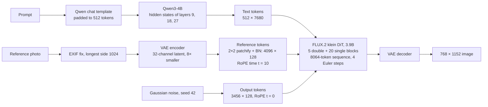

# FLUX.2 [klein] 4B photo editing: BF16 vs INT8 vs INT4 on an A100

One reference photo and one text prompt go in; one edited image comes out after 4 denoising steps. The notebook runs the same edit three times, with BF16, INT8 and INT4 weights. For each run it reports generation time, GPU memory, weight storage, and how far the quantized image drifts from the BF16 image.

This is scheme **S2c** from our face-to-body experiments: use the original photo as the reference image and describe the change in text. It was first built to test body-shape edits such as "make him look a bit fat" or "very muscular". This version takes any free-form prompt, and the default prompt is a dance pose. It is a GPU research benchmark, not a phone deployment package.

[](https://colab.research.google.com/github/OWNER/REPO/blob/main/klein_S2c_custom_prompts_baked_int4fast_en.ipynb)

Replace `OWNER/REPO` in the badge link after pushing.

---

## Results at a glance

Setup: A100-SXM4-40GB, PyTorch 2.11 + CUDA 13.0, diffusers 0.39.0, transformers 4.57.6, optimum-quanto 0.2.7. Output 768×1152, reference photo 1024×1024, 4 steps, seed 42, one image per group.

|                                   | BF16     | INT8     | INT4     |
|-----------------------------------|----------|----------|----------|
| Generation time (end to end)      | 1.89 s   | 2.02 s   | 2.13 s   |
| Speed relative to BF16            | 1.00×    | 0.93×    | 0.89×    |
| Weights resident on the GPU       | 14.9 GiB | 7.9 GiB  | 4.6 GiB  |
| Peak GPU memory while generating  | 17.0 GiB | 10.0 GiB | 6.7 GiB  |
| Pixel PSNR against the BF16 image | n/a      | 24.9 dB  | 16.7 dB  |

What the numbers show:

- **Quantization shrinks memory, not time.** Weights are stored in 8 or 4 bits, but every matrix multiply still runs in BF16. On an A100 the quantized groups are therefore slightly slower.
- **The first INT4 version was much slower.** It used Quanto's built-in INT4 kernel and took 11.98 s for the same image (see [why INT4 was 6× slower at first](#why-int4-was-6-slower-at-first)).
- **Prompt wording does not affect time or memory.** The prompt is always padded to 512 tokens. The numbers above were measured with the dance prompt in Chinese and also apply to the English prompt; only the images differ.

---

## Technical approach

### Pipeline



### The models

| Component | Parameters | Role |
|---|---|---|
| Qwen3-4B text encoder | 4.02 B | Decoder-only LLM: 36 layers, hidden size 2560, GQA with 32 query and 8 KV heads. The pipeline uses it as a feature extractor: it concatenates the hidden states after layers 9, 18 and 27 into a 7680-dim vector per token. Because it is multilingual, Chinese and English prompts both work. |
| FLUX.2 VAE | 84 M | Convolutional autoencoder with 8× downsampling to 32 latent channels. Latents are patchified 2×2 into 128-channel tokens, one token per 16×16 pixels, then normalized with the VAE's BatchNorm statistics. |
| FLUX.2 [klein] DiT | 3.88 B | MMDiT with width 3072 (24 heads × 128). Five double-stream blocks use separate text and image weights with joint attention. Twenty single-stream blocks use shared weights, with attention and a SwiGLU MLP fused into one parallel block. All blocks share one set of modulation weights. Position encoding is a 4-axis RoPE over (t, h, w, l). |

**How editing works.** There is no adapter, ControlNet or extra image encoder. The reference photo's latent tokens are concatenated into the same sequence as the noisy output tokens. The only thing that marks them as a separate image is the RoPE time coordinate: t = 10 for the reference, t = 0 for the output. Attention lets every output token look at every reference token, which is how identity, clothing and lighting carry over.

**How sampling works.** The model is a rectified flow: x_σ = (1 − σ)·x₀ + σ·ε, and it predicts the velocity v = ε − x₀. Generation integrates from σ = 1 to 0 with 4 Euler steps. The schedule for this output size is 1 → 0.966 → 0.904 → 0.757 → 0, so the last step jumps straight to the clean image. klein is step-distilled with guidance baked in, so CFG = 1 and each step needs a single forward pass.

### Where the compute goes, per image

| Stage | FLOPs |
|---|---|
| Qwen3 text encoding (512 tokens) | 4.3 T |
| VAE encoding of the 1024×1024 reference | 4.9 T |
| DiT, one step (8064-token sequence) | 69.5 T (49.5 linear + 20.0 attention) |
| DiT, 4 steps | 277.9 T |
| VAE decoding to 768×1152 | 8.8 T |
| **Total** | **≈ 296 T** |

The DiT sequence is 512 text tokens, 4096 reference tokens and 3456 output tokens. Half of it is the reference image, and those tokens are recomputed at every step. The DiT accounts for 94% of all compute. BF16 runs the whole image at about 156 TFLOPS, half of the A100's peak.

### The three precisions

| Group | How weights are stored | How a matrix multiply runs |
|---|---|---|
| BF16 | bfloat16 | cuBLAS BF16 GEMM |
| INT8 | Quanto `qint8`, symmetric per output channel (absmax) | Each layer is expanded to a BF16 weight (int8 × scale), then cuBLAS |
| INT4 | Quanto `qint4` numerics: asymmetric min–max over groups of 128 input channels, round to nearest. Two values per byte plus a bf16 scale and zero per group, 0.53 bytes per parameter | Each layer is unpacked to BF16 by three elementwise kernels, then cuBLAS (`klein_w4a16.py`) |

Scope of quantization:

- **Quantized:** every `nn.Linear` in the DiT and in the Qwen3 encoder, except the DiT's `proj_out` and Qwen's `lm_head` (which shares its weights with the embeddings).
- **Not quantized:** embeddings, normalization layers, and the whole VAE. Activations stay in BF16.
- **No calibration** is done.
- **Each precision runs in its own process.** After conversion the code checks that every targeted layer is actually quantized, and fails rather than silently falling back to BF16.

### Why INT4 was 6× slower at first

On CUDA, Quanto sends `qint4` + BF16 matmuls to **tinygemm** (`torch._weight_int4pack_mm`). That kernel was written for LLM decoding, where a matmul has 1–16 rows.

- **How the kernel works.** Each thread block computes a single 16×8 output tile. It reads its inputs straight from memory into registers, with no shared-memory reuse.
- **What happens on the DiT's matmuls.** These have 8064 rows. In the largest layer (8064×3072 by 3072×27648), every weight is re-read and re-dequantized 504 times, and every activation is re-read 3456 times.
- **The cost.** That is about 7 FLOPs per byte moved, against about 85 for cuBLAS's large tiles. The linear layers ran at ~18 TFLOPS, about 12× slower than BF16, and the whole image took 11.98 s.

The fix in `klein_w4a16.py` keeps exactly the same INT4 data:

- **Same quantization.** It calls Quanto's own `MaxOptimizer` and `quantize_affine`, so the int4 values, scales and shifts are bit-identical.
- **Same reconstructed weights.** Dequantization reproduces tinygemm's GPU arithmetic `bf16(fma(q − 8, scale, zero))`, verified bit for bit.
- **Different matmul kernel.** Each layer is expanded to BF16 and multiplied with cuBLAS.

At startup the notebook checks the largest DiT matmul. It took 6.38 ms in BF16 and 6.95 ms in INT4, of which 1.20 ms was the dequantization. The INT4 images from the old and new kernels look the same. They differ only by matmul accumulation order.

The old path is still available with `INT4_BACKEND = 'quanto_tinygemm'`.

---

## How to run it yourself

### What you need

- **A Google Colab A100 runtime.** A100 runtimes usually require a paid Colab plan.
- **Other GPUs** are untested. They need BF16 support (NVIDIA Ampere or newer) and at least 24 GB of memory, because the BF16 group peaks at about 17 GiB allocated and 18.5 GiB reserved.
- **About 16 GB of disk** for the model download (`black-forest-labs/FLUX.2-klein-4B`, Apache-2.0). Colab has enough.
- **No local setup.** Everything installs inside the notebook.

### Steps

1. Open the notebook in Colab, using the badge above or *File → Upload notebook*.
2. *Runtime → Change runtime type → A100 GPU*.
3. Run **section 1**. It installs diffusers, transformers and optimum-quanto, keeps Colab's own PyTorch, and prints the GPU name.
4. Edit **section 2** (form fields in Colab): the prompt, which precisions to run, and image settings. See the table below.
5. Run every remaining cell in order.
   - **Section 5** downloads the model the first time, which takes a few minutes.
   - **Section 6** runs BF16, INT8 and INT4 one after another. Each group takes roughly 15–30 s for one image once the model is cached.
6. Read the results:
   - **Section 8** shows the summary table and a comparison grid.
   - **Section 9** downloads everything as a ZIP. Unzip it before opening `report.html`.

If the download asks for authentication, run `from huggingface_hub import notebook_login; notebook_login()` and paste a Hugging Face token.

To try more prompts, edit section 2 and re-run from section 2 onward. Section 1 does not need to be run again.

### Using your own photo

The notebook ships with one built-in reference photo, stored as base64 inside the notebook. To use your own photo:

1. In section 2, set `USE_BAKED_IMAGE = False` and `ALSO_UPLOAD = True`.
2. Run section 4. It opens an upload dialog.

Keep both options on to run the built-in photo and your uploads together. Any image works. It is not cropped: it is only EXIF-rotated and scaled so its longest side equals `REF_MAX_SIDE`.

### Settings (section 2)

| Setting | Default | Meaning |
|---|---|---|
| `PROMPT` | dance prompt | Sent to the model verbatim. Nothing is translated or appended, so if you want the face or clothes kept, say so. |
| `EXTRA_PROMPTS` | `[]` | More prompts. Every prompt runs on every image. |
| `PRECISION_MODE` | `bf16,int8,int4` | Pick `bf16` alone to just try a prompt quickly. |
| `USE_BAKED_IMAGE` / `ALSO_UPLOAD` | `True` / `False` | Where the reference images come from. At least one must be on. |
| `INT4_BACKEND` | `dequant_bf16` | Fast INT4 path. `quanto_tinygemm` reproduces the old, ~6× slower path. It also compiles a CUDA extension for 3–4 minutes the first time. |
| `WIDTH`, `HEIGHT` | 768, 1152 | Output size in pixels, multiples of 16. |
| `REF_MAX_SIDE` | 1024 | Longest side of the reference. 768 cuts the reference tokens from 4096 to 2304 and makes the DiT noticeably cheaper, but the model sees less detail. |
| `SEED` | 42 | The same seed is used for every precision. |
| `WARMUP_RUNS` | 1 | Untimed full generations before measuring. |
| `REPEATS` | 1 | Timed repeats per image. Use 3 for stable timings. |
| `QUANTIZE_COMPONENTS` | transformer, text_encoder | Use `['transformer']` to quantize the DiT only. |
| `EXCLUDE` | `proj_out`, `lm_head` | `fnmatch` patterns of Linear layers to keep in BF16. |
| `RUN_ID_METRICS` | `False` | ArcFace identity similarity, computed on the CPU after generation. Useful for portrait edits only. |
| `LOCAL_MODEL_PATH` | empty | Use a local Diffusers copy of the model instead of downloading it. |

---

## Reading the results

### Output folder

```
klein_custom_<date>_<time>/
├── config.json             all settings, the pinned model revision, every case
├── prompts.json            the exact prompts that were sent
├── requirements_freeze.txt package versions
├── inputs/                 imageNN_photo.png and imageNN_reference.png (what the model saw)
├── bf16/  int8/  int4/
│   ├── imageNN_pXX_custom__<precision>__r0.png   generated images
│   ├── results.json        one row per generated image
│   ├── model_stats.json    load/quantize time, storage per component, per-layer quantization map, INT4 self-check
│   ├── environment.json    GPU, CUDA and package versions
│   ├── run.log             full log of that precision's worker process
│   └── status.json         complete / partial / failed, with the traceback on failure
├── summary.csv             one row per precision
├── metrics.csv             one row per generated image
├── grid_<case>.png         reference + one column per precision
├── report.html             everything above, with full prompts and full-size images
├── identity.json           only when RUN_ID_METRICS = True
└── code/                   the exact modules that produced this run
```

### `summary.csv`: one row per precision

| Column | Meaning |
|---|---|
| `kernel` | How this group's matrix multiplies actually ran. |
| `generation_median_s` | Median end-to-end time of one generation. |
| `paired_speedup_median` | BF16 time ÷ this group's time, paired image by image. Below 1 means slower than BF16. |
| `peak_allocated_gib` | Highest GPU memory PyTorch actually allocated during generation: weights plus activations. |
| `peak_reserved_gib` | Memory held by PyTorch's caching allocator. Closer to what `nvidia-smi` shows. |
| `resident_allocated_gib` | Memory still allocated after loading and quantizing, i.e. the weights. |
| `tensor_storage_mib` | Bytes of all weight and buffer tensors, including packed integers and scales. |
| `load_s`, `quantize_s` | Model loading and quantization time. Never included in generation time. |
| `n_ok` / `n_expected` | How many images succeeded. |
| `id_sim_mean` | Mean ArcFace similarity to the reference, if enabled. |

### `metrics.csv`: one row per generated image

| Column | Meaning |
|---|---|
| `generation_e2e_s` | Time of this one generation. |
| `actual_steps` | Always 4. The run fails if it is not. |
| `incremental_peak_gib` | Activation memory on top of the weights. About 2 GiB at 768×1152 and the same for every precision; most likely reached during VAE decoding. |
| `mae_vs_bf16`, `psnr_vs_bf16_db` | Pixel difference from the BF16 image with the same prompt and seed. |
| `speedup_vs_bf16` | BF16 time ÷ this image's time. |
| `image_std`, `near_uniform_warning` | Flags blank or gray outputs. |

**What is timed:** one call of the pipeline. That includes tokenization, Qwen3 encoding, VAE encoding of the reference, the 4 DiT steps, VAE decoding, and copying the image to the CPU.

**What is not timed:** model download, loading, quantization, warm-up, saving PNGs and identity evaluation.

### How to interpret the numbers

**Speed.** Weight-only quantization does not reduce FLOPs: activations stay BF16 and every matmul is a BF16 matmul. On a GPU the quantized groups therefore pay a small dequantization cost and run slightly slower. These A100 timings say nothing about INT8/INT4 speed on a phone NPU, which depends on whether the NPU has integer kernels for these large matrix multiplies.

**Memory.** INT8 halves the resident weights and INT4 cuts them to about a third. The ~2 GiB of activations does not change with weight precision.

**Quality.** `psnr_vs_bf16_db` measures drift, not quality. This 4-step distilled model amplifies tiny numeric differences:

- The same INT4 weights run through two different matmul kernels gave images 27.4 dB apart.
- INT8 at 24.9 dB from BF16 is therefore close to that noise floor.
- INT4 at 16.7 dB is clearly further away.

Look at the images instead. In our run, INT8 looked essentially the same as BF16. INT4 kept the pose and the overall composition, but dropped the vest the BF16 image had and shifted the colors cooler and darker.

To compare quality properly:

- Use several seeds and prompts.
- For portraits, turn on `RUN_ID_METRICS`. `id_sim` is a cosine similarity, not a probability, and it is only comparable between outputs of the same input and edit.

**Determinism.** With the same settings, BF16 and INT8 images were bit-identical across two separate runs, so differences between groups come from the weights rather than run-to-run noise.

---

## Known limitations

- **Loading is not low-memory.** The full BF16 model is loaded before quantizing, so the load-and-quantize peak is about 15 GiB even for INT4.
- **INT4 is plain round-to-nearest with no calibration,** and the shared modulation layers are quantized too. One untested idea for the color shift is to keep them in BF16 by setting `EXCLUDE['transformer']` to `['proj_out', '*modulation*', 'time_guidance_embed.*', 'norm_out.*', 'context_embedder', 'x_embedder']`.
- **Part of the Qwen3 compute is wasted.** All 36 layers and the `lm_head` run even though only the first 27 layers' outputs are used. Truncating would save ~1.4 TFLOPs and ~1.7 GiB without changing outputs. It is not done here, to stay identical to the diffusers pipeline.
- **The reference tokens are recomputed at all 4 steps.** Recent diffusers releases (e.g. 0.42) include `Flux2KleinKVPipeline`, which caches them after the first step. For this reference that removes about 38% of the DiT FLOPs, but it changes how reference tokens attend, so quality would need checking.
- **The INT4 path still has about 13% overhead,** almost all of it the three dequantization kernels. A fused kernel could bring this down to a few percent.
- **The results come from one image, one seed and `REPEATS = 1`.** The ~7% INT8 slowdown should be confirmed with `REPEATS = 3`.
- **The optional identity metric uses InsightFace `buffalo_l` weights, which are licensed for non-commercial research only.**

---

## References

- [FLUX.2 [klein] 4B model card](https://huggingface.co/black-forest-labs/FLUX.2-klein-4B)
- [FLUX.2 [klein] announcement](https://bfl.ai/blog/flux2-klein-towards-interactive-visual-intelligence)
- [`Flux2KleinPipeline` source (diffusers)](https://github.com/huggingface/diffusers/blob/main/src/diffusers/pipelines/flux2/pipeline_flux2_klein.py)
- [optimum-quanto](https://github.com/huggingface/optimum-quanto)
- [tinygemm INT4 kernel source (`int4mm.cu`, PyTorch)](https://github.com/pytorch/pytorch/blob/main/aten/src/ATen/native/cuda/int4mm.cu)
- [Memory-efficient Diffusion Transformers with Quanto and Diffusers](https://huggingface.co/blog/quanto-diffusers)
